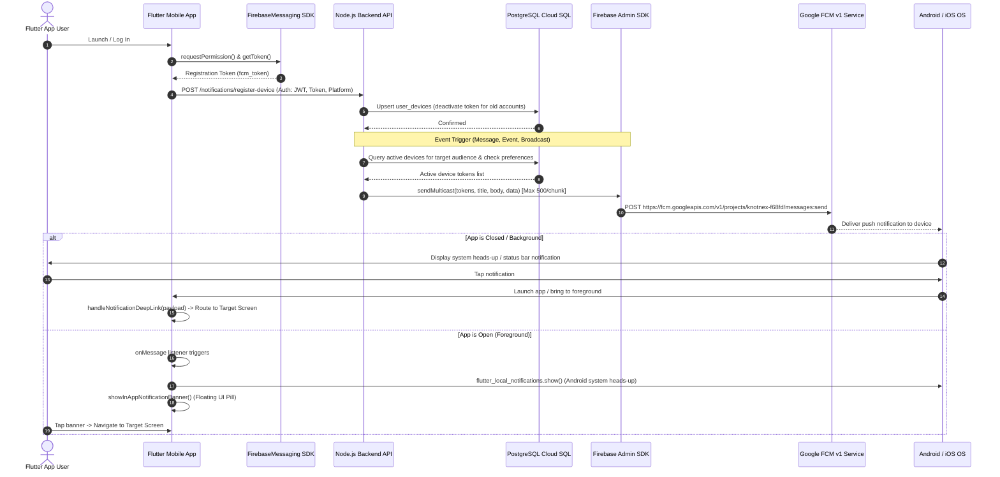

# KnotNex — Unified Push Notification Architecture & System Design

## 1. High-Level Architecture Overview

```
┌────────────────────────────────────────────────────────────────────────┐
│                        KnotNex Flutter Client                          │
│                                                                        │
│  [ Firebase.initializeApp ] ──► [ FirebaseMessaging.getToken() ]       │
│                                          │                             │
│                                          ▼                             │
│  [ Local Notifications ] ◄─── [ onMessage Listener (Foreground) ]     │
│           ▲                                                            │
│           │ OS Heads-up Banner                                         │
└───────────┼──────────────────────────────┬─────────────────────────────┘
            │                              │ POST /api/v1/notifications/
            │                              │   register-device (Bearer JWT)
            │                              ▼
┌───────────┼────────────────────────────────────────────────────────────┐
│           │                   KnotNex Backend API                      │
│           │                                                            │
│           │         ┌─────────────────────────────────────┐            │
│           │         │     NotificationController          │            │
│           │         └──────────────────┬──────────────────┘            │
│           │                            │                               │
│           │         ┌──────────────────▼──────────────────┐            │
│           │         │      NotificationService            │            │
│           │         └──────┬───────────────────────┬──────┘            │
│           │                │                       │                   │
│           │                ▼                       ▼                   │
│           │     ┌────────────────────┐   ┌─────────────────────┐       │
│           │     │  PostgreSQL Cloud  │   │  FcmIntegration     │       │
│           │     │  SQL (user_devices)│   │  (FCM HTTP v1 SDK)  │       │
│           │     └────────────────────┘   └─────────┬───────────┘       │
│           │                                        │                   │
└───────────┼────────────────────────────────────────┼───────────────────┘
            │                                        │ OAuth 2.0 (FCM v1)
            │                                        ▼
┌───────────┴────────────────────────────────────────────────────────────┐
│                    Google Firebase Cloud Messaging                     │
│                                                                        │
│                [ FCM HTTP v1 Messaging Endpoints ]                     │
│                                │                                       │
│                                ▼                                       │
│          [ Android Google Play Services / Apple APNs ]                 │
└────────────────────────────────┬───────────────────────────────────────┘
                                 │
                                 ▼
                     Target User's Device
```

---

## 2. End-to-End Delivery Sequence



---

## 3. Core Architectural Rules

### A. Token Lifecycle Management
1. **Authenticated Association**: Tokens are never stored without a verified JWT bearer token.
2. **Re-assignment on Shared Devices**: If Device Token $T$ was previously attached to User $A$, and User $B$ logs in on the same device, registering $(B, T)$ immediately flags $(A, T)$ as `is_active = FALSE`.
3. **Deactivation on Logout**: Invoking `POST /notifications/unregister-device` immediately flags the token as `is_active = FALSE`.
4. **Token Pruning on Delivery**: If FCM returns `UNREGISTERED` (`messaging/registration-token-not-registered`) during multicast, the token is automatically set to `is_active = FALSE`.

### B. FCM HTTP v1 Multicast Batching
1. **500-Token Chunking**: Firebase Admin SDK limits multicast to 500 recipients per call. The sender splits lists $> 500$ into sub-batches:
   $$\text{Batch}_k = \text{Tokens}[(k \times 500) \dots ((k + 1) \times 500 - 1)]$$
2. **Failure Isolation**: Each batch result is individually inspected. Permanent failures mark tokens inactive; transient failures can be queued for retry.

### C. Standardized Versioned Payload Structure
All FCM push messages use a standardized string-encoded data payload:
```json
{
  "schema_version": "1.0",
  "notification_id": "uuid",
  "type": "message | event | career | scheme | post | broadcast",
  "category": "announcement | system | social",
  "title": "String",
  "body": "String",
  "target_id": "String (entity id)",
  "route": "knotnex://events/:id",
  "click_action": "FLUTTER_NOTIFICATION_CLICK",
  "sent_at": "ISO-8601 Timestamp"
}
```
