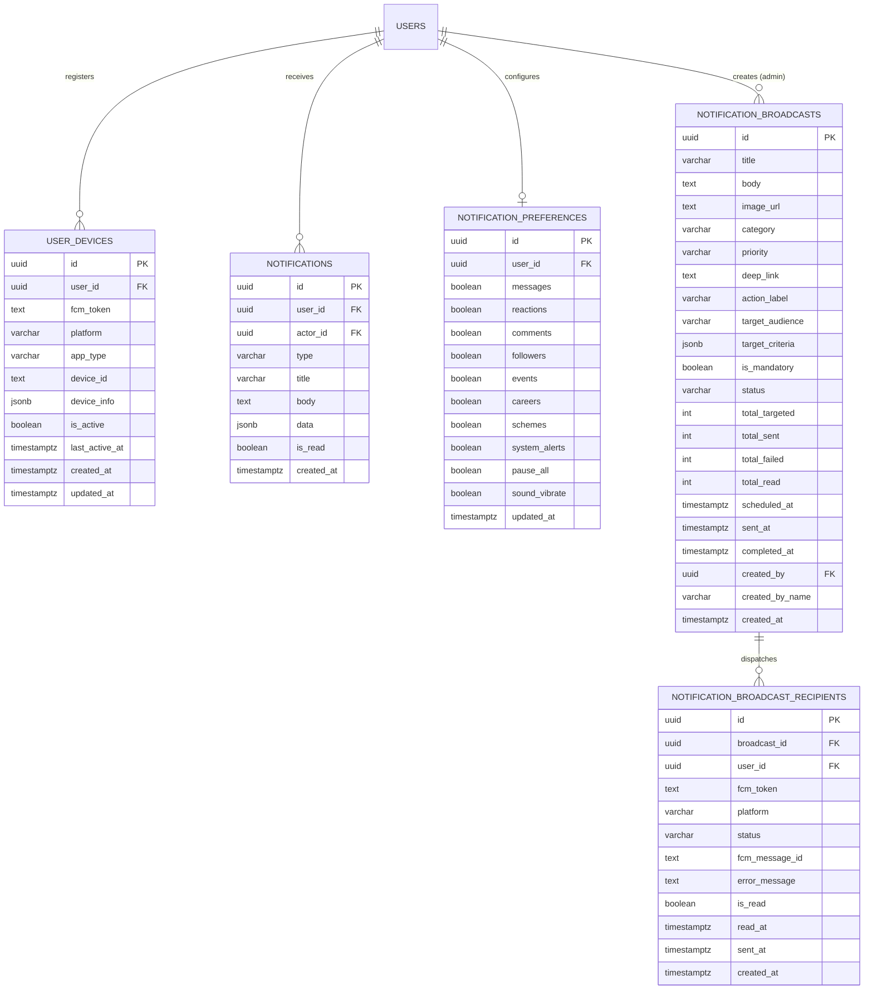

# KnotNex — Notification Database Schema & State Machine Design

## 1. Entity-Relationship Model



---

## 2. Table Definitions & SQL Constraints

### 2.1 `user_devices`
```sql
CREATE TABLE IF NOT EXISTS user_devices (
    id UUID PRIMARY KEY DEFAULT gen_random_uuid(),
    user_id UUID NOT NULL REFERENCES users(id) ON DELETE CASCADE,
    fcm_token TEXT NOT NULL,
    platform VARCHAR(20) DEFAULT 'android', -- 'android', 'ios', 'web'
    app_type VARCHAR(30) DEFAULT 'knotnex_user', -- 'knotnex_user', 'knotnex_org'
    device_id TEXT,
    device_info JSONB DEFAULT '{}'::jsonb,
    is_active BOOLEAN DEFAULT TRUE,
    last_active_at TIMESTAMPTZ DEFAULT NOW(),
    created_at TIMESTAMPTZ DEFAULT NOW(),
    updated_at TIMESTAMPTZ DEFAULT NOW(),
    CONSTRAINT uq_user_fcm_token UNIQUE (user_id, fcm_token)
);

CREATE INDEX IF NOT EXISTS idx_user_devices_lookup ON user_devices (user_id, is_active) WHERE is_active = TRUE;
CREATE INDEX IF NOT EXISTS idx_user_devices_token ON user_devices (fcm_token);
```

### 2.2 `notification_broadcasts`
```sql
CREATE TABLE IF NOT EXISTS notification_broadcasts (
    id UUID PRIMARY KEY DEFAULT gen_random_uuid(),
    title VARCHAR(255) NOT NULL,
    body TEXT NOT NULL,
    image_url TEXT,
    category VARCHAR(50) DEFAULT 'announcement',
    priority VARCHAR(20) DEFAULT 'normal',
    deep_link TEXT,
    action_label VARCHAR(100),
    target_audience VARCHAR(50) DEFAULT 'all',
    target_criteria JSONB DEFAULT '{}'::jsonb,
    is_mandatory BOOLEAN DEFAULT FALSE,
    status VARCHAR(30) DEFAULT 'draft',
    total_targeted INT DEFAULT 0,
    total_sent INT DEFAULT 0,
    total_failed INT DEFAULT 0,
    total_read INT DEFAULT 0,
    scheduled_at TIMESTAMPTZ,
    sent_at TIMESTAMPTZ,
    completed_at TIMESTAMPTZ,
    created_by UUID REFERENCES users(id) ON DELETE SET NULL,
    created_by_name VARCHAR(150),
    metadata JSONB DEFAULT '{}'::jsonb,
    created_at TIMESTAMPTZ DEFAULT NOW(),
    updated_at TIMESTAMPTZ DEFAULT NOW()
);

CREATE INDEX IF NOT EXISTS idx_broadcasts_status ON notification_broadcasts (status, created_at DESC);
CREATE INDEX IF NOT EXISTS idx_broadcasts_scheduled ON notification_broadcasts (scheduled_at) WHERE status = 'scheduled';
```

---

## 3. Delivery Lifecycle State Machine

```
[CREATED] ──► [QUEUED] ──► [PROCESSING]
                             │
            ┌────────────────┴────────────────┐
            ▼                                 ▼
       [SUBMITTED]                         [FAILED]
            │                                 │
     (FCM Gateway)                      (Retryable?)
            │                            ├── Yes ──► [RETRYING]
            │                            └── No  ──► [INVALID_TOKEN]
            ▼
        [OPENED] ──► [READ]
```

### Status Definitions:
- `CREATED`: Broadcast draft or notification object initialized.
- `QUEUED`: Scheduled notification awaiting its trigger time.
- `PROCESSING`: FCM multicast batch is executing.
- `SUBMITTED`: Google FCM HTTP v1 accepted the message with a valid Message ID.
- `FAILED`: Google FCM rejected the payload (permanent payload error or quota error).
- `RETRYING`: Transient network or 503 error awaiting exponential backoff.
- `INVALID_TOKEN`: Token flagged as unregistered by FCM (`messaging/registration-token-not-registered`).
- `OPENED`: Notification tapped by user on mobile operating system.
- `READ`: In-app notification marked as read in the notification center.
