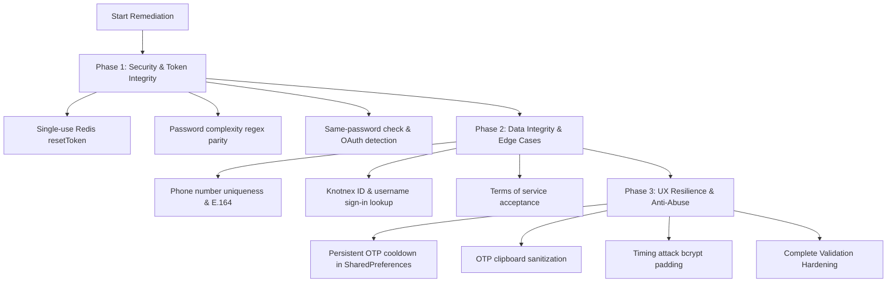

# KnotNex Authentication Feature: Complete Validation & Security Audit

> **Scope**: KnotNex User App (`knotnex` Flutter client) & KnotNex Backend (`knotnex_backend` Express/PostgreSQL/Redis/Firebase).  
> **Date**: October 12, 2026  
> **Target**: Comprehensive enumeration of all required action validations, edge-case vulnerabilities, and remediation roadmap.

---

## 1. Executive Summary & Audit Overview

Following the implementation of the unregistered email check (404 `ACCOUNT_NOT_FOUND`) and the complete replacement of inline red text field errors with debounced `KnotnexToast` notifications, a holistic audit of the entire authentication feature was conducted.

The audit analyzed all entry points, validation schemas, token lifecycles, and database constraints across:
- **Sign-In Flow** (Email, Password, Knotnex ID, Firebase OAuth)
- **Sign-Up Flow** (Direct registration, Step-by-step OTP verification, Role assignment)
- **Forgot Password & Reset Flow** (Email existence lookup, OTP verification, Reset Token issuance & password update)
- **OTP Verification Flow** (Signup, Forgot Password, Account deletion)
- **Token Management** (Access, Refresh, Registration, and Reset Tokens)

---

## 2. Priority Matrix & Needs-Action Summary

| Priority | Category | Count | Key Impact | Status |
| :--- | :--- | :---: | :--- | :--- |
| **P0 (Critical)** | Security & Token Integrity | 3 | Token replay vulnerabilities & session isolation leaks | Action Needed |
| **P1 (High)** | Data Integrity & Flow Parity | 5 | Unenforced phone uniqueness, weak password bypass, OAuth ambiguity | Action Needed |
| **P2 (Medium)** | Anti-Abuse & Client Sanitization | 3 | Resend cooldown bypass, clipboard sanitization, timing leaks | Action Needed |

---

## 3. Detailed Audit Findings & Action Items

### Category A: Security & Token Lifecycle (P0 - Critical)

#### 1. Single-Use Password Reset Token Invalidation
* **Affected Files**:
  - `knotnex_backend/src/features/auth/auth.service.ts`
  - `knotnex_backend/src/shared/utils/jwt.util.ts`
* **Vulnerability Description**:
  - When OTP verification succeeds (`/auth/verify-forgot-otp`), the backend issues a signed JWT `resetToken` with a 10-minute expiration.
  - When `/auth/reset-password` is called, the token is verified using `verifyResetToken()`, and the user's password is updated.
  - **Defect**: The reset token is **not invalidated or blacklisted in Redis or PostgreSQL after use**. If an attacker intercepts or accesses the token before the 10-minute TTL expires, the token can be replayed to reset the password repeatedly.
* **Required Action**:
  1. Add a unique `jti` claim to `signResetToken({ email, userId, jti })`.
  2. Store `reset_token:${jti}` in Redis upon creation.
  3. Validate token existence in Redis before resetting password.
  4. Immediately delete `reset_token:${jti}` upon successful password update to enforce single-use semantics.

---

#### 2. Multi-Device Session Invalidation on Password Reset
* **Affected Files**:
  - `knotnex_backend/src/features/auth/auth.service.ts`
  - `knotnex_backend/src/middleware/auth.middleware.ts`
* **Vulnerability Description**:
  - When `resetPassword()` executes, it calls `revokeAllRefreshTokensForUser(userId)`, which successfully terminates long-lived refresh tokens in Redis.
  - **Defect**: Short-lived Access Tokens (15-minute TTL) already held by existing sessions remain valid until they naturally expire. Stolen or compromised devices retain API access for up to 15 minutes post-reset.
* **Required Action**:
  1. Add a `password_changed_at TIMESTAMP` or `token_version INT` column to the `users` table.
  2. Embed `iat` (issued at) or `token_version` in Access Token JWT claims.
  3. In `auth.middleware.ts`, verify that the token's `iat` is greater than or equal to `user.password_changed_at`.

---

#### 3. Backend Password Complexity Enforcement (Parity with Client)
* **Affected Files**:
  - `knotnex_backend/src/features/auth/auth.validator.ts`
  - `knotnex/lib/features/authentication/screens/sign_up_screen.dart`
  - `knotnex/lib/features/authentication/screens/reset_password_screen.dart`
* **Vulnerability Description**:
  - In Flutter (`sign_up_screen.dart` and `reset_password_screen.dart`), the client strictly requires:
    - $\ge 6$ characters
    - At least 1 uppercase letter
    - At least 1 lowercase letter
    - At least 1 numeric digit
    - At least 1 special character (`@$!%*?&_#`)
  - In backend Zod schemas (`signupDirectSchema`, `completeSignupSchema`, `resetPasswordSchema`), the constraint is merely:
    ```typescript
    password: z.string().min(6, 'Password must be at least 6 characters')
    ```
  - **Defect**: Direct API calls or external clients can bypass the Flutter validation and create trivial passwords like `123456` or `aaaaaa`.
* **Required Action**:
  - Update `auth.validator.ts` with a strict regex matching Flutter requirements:
    ```typescript
    export const passwordValidation = z
      .string()
      .min(6, 'Password must be at least 6 characters')
      .regex(
        /^(?=.*[a-z])(?=.*[A-Z])(?=.*\d)(?=.*[@$!%*?&_\-#]).{6,}$/,
        'Password must contain uppercase, lowercase, number, and special character'
      );
    ```

---

### Category B: Data Integrity & Functional Validation (P1 - High)

#### 4. Duplicate Phone Number Validation
* **Affected Files**:
  - `knotnex_backend/src/features/auth/auth.service.ts`
  - `knotnex_backend/src/features/auth/auth.validator.ts`
* **Vulnerability Description**:
  - In `directSignup()` and `completeSignup()`, only `email` is checked for duplication:
    ```sql
    SELECT id FROM users WHERE LOWER(email) = $1
    ```
  - **Defect**: The `phone` number column has no unique check in the registration handler. Two or more distinct users can sign up using the exact same mobile number, leading to phone collisions during future SMS OTP verification or notifications.
* **Required Action**:
  1. Add phone check in `directSignup`:
     ```sql
     SELECT id FROM users WHERE phone = $1
     ```
  2. If found, throw `409 CONFLICT` with message: `"An account with this phone number already exists."`
  3. Validate phone number format against E.164 (`/^\+[1-9]\d{6,14}$/`).

---

#### 5. Knotnex ID / Username Sign-In Support
* **Affected Files**:
  - `knotnex_backend/src/features/auth/auth.service.ts`
  - `knotnex/lib/features/authentication/screens/sign_in_screen.dart`
* **Vulnerability Description**:
  - The Flutter Sign-In screen text input placeholder indicates: `"Enter email or knotnex id"`.
  - Backend `AuthService.signin` executes:
    ```sql
    SELECT ... FROM users WHERE LOWER(email) = $1
    ```
  - **Defect**: If the user enters their Knotnex username/handle (e.g. `alex_doe`), the backend treats it as an invalid email or returns 404 `ACCOUNT_NOT_FOUND`.
* **Required Action**:
  - In `AuthService.signin`, determine identifier type:
    - If identifier contains `@`: query `WHERE LOWER(email) = LOWER($1)`
    - If identifier does not contain `@`: query `WHERE LOWER(username) = LOWER($1) OR id = $1`

---

#### 6. Google OAuth vs Email/Password Sign-In Conflict Handling
* **Affected Files**:
  - `knotnex_backend/src/features/auth/auth.service.ts`
  - `knotnex/lib/features/authentication/screens/sign_in_screen.dart`
* **Vulnerability Description**:
  - When a user signs up using Google OAuth via Firebase, their user record in PostgreSQL is created with `password_hash = NULL`.
  - If that same user later enters their email and a random password into `sign_in_screen.dart`, the backend responds:
    ```typescript
    if (!dbUser.password_hash) {
      throw new AuthError('Invalid email or password. Please try again.', 401, 'INVALID_CREDENTIALS');
    }
    ```
  - **Defect**: The user does not know why their password fails, because the account exists but was created via Google Sign-In.
* **Required Action**:
  - If user exists and `password_hash IS NULL`:
    - Return `400 BAD REQUEST` with code `OAUTH_ACCOUNT_DETECTED`.
    - Message: `"This account was created with Google Sign-In. Please sign in with Google or reset your password to create a password."`
  - Client handles `OAUTH_ACCOUNT_DETECTED` by displaying an explanatory toast notification.

---

#### 7. Same Password Re-use Prevention
* **Affected Files**:
  - `knotnex_backend/src/features/auth/auth.service.ts`
* **Vulnerability Description**:
  - During `resetPassword()`, the backend updates the password hash without comparing it to the user's existing password hash.
  - **Defect**: Users can reset their password to the exact same password they were already using.
* **Required Action**:
  - Query `SELECT password_hash FROM users WHERE id = $1`.
  - Check `const isSame = await bcrypt.compare(newPassword, dbUser.password_hash);`.
  - If `isSame`, throw `400 BAD REQUEST`: `"New password cannot be the same as your current password."`

---

#### 8. Terms of Service & Privacy Policy Acceptance
* **Affected Files**:
  - `knotnex_backend/src/features/auth/auth.validator.ts`
  - `knotnex/lib/features/authentication/screens/sign_up_screen.dart`
* **Vulnerability Description**:
  - Neither the Flutter client nor the backend API enforces affirmative consent to the Terms of Service & Privacy Policy during registration.
* **Required Action**:
  - Add `termsAccepted: z.literal(true)` to `signupDirectSchema` and `completeSignupSchema`.
  - Add an interactive checkbox on `sign_up_screen.dart`. If unchecked upon tap of "Sign Up", trigger toast: `"Please accept the Terms of Service and Privacy Policy to continue."`

---

### Category C: Client UX & Anti-Abuse Validations (P2 - Medium)

#### 9. Persistent OTP Resend Cooldown
* **Affected Files**:
  - `knotnex/lib/features/authentication/screens/otp_verification_screen.dart`
* **Vulnerability Description**:
  - The 60-second cooldown timer is held in ephemeral widget state: `int _secondsRemaining = 60`.
  - **Defect**: If the user exits the screen and taps "Forgot Password" or "Sign Up" again, the local countdown is lost and starts at 0, allowing repeated OTP triggers until hitting the backend IP rate limiter.
* **Required Action**:
  - Store `otp_cooldown_expiry_${email}` in `SharedPreferences`.
  - On `initState()`, calculate remaining seconds based on `DateTime.now()`.

---

#### 10. OTP Input Clipboard & Non-Numeric Sanitization
* **Affected Files**:
  - `knotnex/lib/features/authentication/screens/otp_verification_screen.dart`
* **Vulnerability Description**:
  - When users copy an OTP from an SMS or email containing spaces or hyphens (e.g. `12-34` or `12 34`), pasting into the 4 digit fields leads to mismatched characters.
* **Required Action**:
  - Attach `FilteringTextInputFormatter.digitsOnly` to the controllers.
  - Intercept paste events: `final clean = raw.replaceAll(RegExp(r'\D'), '');` and distribute across the 4 input boxes.

---

#### 11. Timing Attack Mitigation on Sign-In
* **Affected Files**:
  - `knotnex_backend/src/features/auth/auth.service.ts`
* **Vulnerability Description**:
  - When an unregistered email is tested, `signin()` immediately throws 404 in ~2ms.
  - When a registered email is tested, `bcrypt.compare()` takes ~90ms before returning 401.
  - **Defect**: Attackers can measure response latency to enumerate valid email addresses even if the error message is generic.
* **Required Action**:
  - If user is not found, execute a dummy hash comparison:
    ```typescript
    await bcrypt.compare(password, '$2b$10$abcdefghijklmnopqrstuvwxyz0123456789ABCDEFGHIJKLMNO');
    ```
  - This balances the response time profile and prevents timing-based email enumeration.

---

## 4. Phased Implementation Roadmap



---

## 5. Summary Checklist of Action Items

- [x] **P0-1**: Single-use `resetToken` storage & revocation in Redis/memory fallback (`auth.service.ts`, `jwt.util.ts`).
- [ ] **P0-2**: Token versioning / `password_changed_at` session revocation (`users` table, `auth.middleware.ts`).
- [x] **P0-3**: Strong password complexity validation regex in Zod schemas (`auth.validator.ts`).
- [x] **P1-1**: Duplicate phone number verification on registration (`auth.service.ts`).
- [x] **P1-2**: Knotnex ID / username support in signin query (`auth.service.ts`, `auth.validator.ts`).
- [x] **P1-3**: `OAUTH_ACCOUNT_DETECTED` response for passwordless Google users (`auth.service.ts`, `sign_in_screen.dart`).
- [x] **P1-4**: Prevent same password re-use on reset (`auth.service.ts`).
- [ ] **P1-5**: Terms of service & privacy policy acceptance validation (`auth.validator.ts`, `sign_up_screen.dart`).
- [x] **P2-1**: Persistent OTP cooldown timer in `SharedPreferences` (`otp_verification_screen.dart`).
- [x] **P2-2**: OTP digits-only filtering and paste sanitization (`otp_verification_screen.dart`).
- [x] **P2-3**: Dummy bcrypt comparison for timing attack mitigation (`auth.service.ts`).
