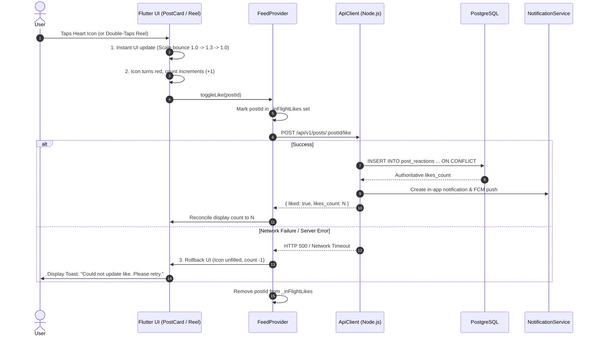
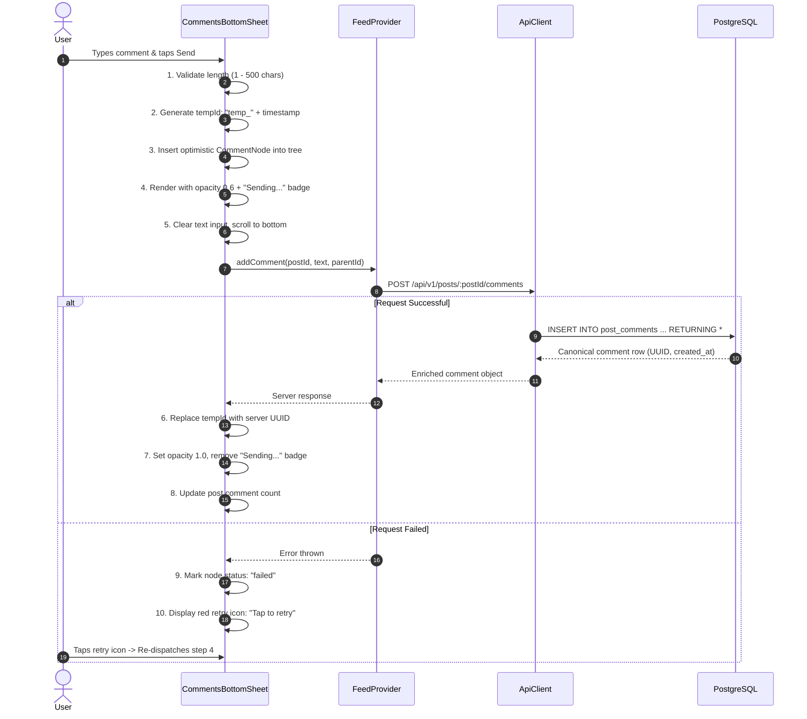

# KnotNex Social Platform — Instagram & LinkedIn Technical Benchmarking
**Document Version:** 1.0.0  
**Context:** Public Industry Engineering Patterns Adapted to KnotNex Platform  
**Target Applications:** Flutter Client (`knotnex`) & Node.js/PostgreSQL Backend (`knotnex_backend`)  

---

## 1. Benchmarking Scope & Methodology

This document evaluates the publicly documented architectural patterns and user interaction paradigms of **Instagram** (Meta) and **LinkedIn** (Microsoft) to establish the technical foundation for KnotNex's social experience.

> **Important Architectural Note:** This analysis is derived exclusively from publicly available engineering blog posts, official developer documentation, public API documentation, and observable client-server interaction patterns. Proprietary internal source code is not referenced. KnotNex implements an original, inclusive architecture inspired by these best practices.

---

## 2. Core Feature Benchmarking Matrix

| Feature Dimension | Instagram Benchmark | LinkedIn Benchmark | KnotNex Target Implementation |
| :--- | :--- | :--- | :--- |
| **Feed Ranking & Delivery** | Heavy visual emphasis, media-first cards, dynamic aspect ratios (1:1, 4:5, 9:16). Cursor-based pagination. | Professional contextual cards, text+media, rich previews, author headline/role tags, connection degrees. | **Hybrid Inclusive Feed**: Author role/headline badge + rich media cards (4:5 image, 1:1 carousel, 9:16 reels, text thoughts). Cursor pagination. |
| **Like / Reaction State** | Immediate local icon toggle + scale spring animation. Micro-debounced HTTP mutation. Silent rollback on failure. | Multi-reaction selector (Like, Celebrate, Support, Insightful). Instant local counter increment. Rollback on failure. | **UI-First Optimistic Like**: Immediate 250ms scale-bounce animation + instant count increment; backend reconciliation with rollback; author push notification. |
| **Comment Submission** | User taps send -> Comment appears immediately at bottom of list with reduced opacity -> Replaced by canonical ID once server confirms. | User submits -> Pending spinner/"Posting..." badge -> Thread re-renders with server response. | **Optimistic Submission with `Sending...` State**: Immediate local insertion with `isPending: true` + "Sending..." caption; canonical UUID reconciliation; tap-to-retry on network drop. |
| **Threaded Replies** | 1-2 levels of nesting with "View X replies" collapsible accordion and vertical guide lines. | 1 level of nested replies beneath parent comment; author highlighted if original poster. | **Two-Level Threading**: Visual ancestor connector lines; `@mention` prefix automatic insertion; collapsible reply trees. |
| **Reels Video Playback** | Vertical full-screen swipe. Next 1-2 videos preloaded in background memory. Autoplay when >50% viewport. Single active audio session. | Video autoplay in-feed with muted default; tap to unmute. | **Lifecycle-Managed Reels**: Full-screen vertical swipe; active video memory management; pause on scroll; double-tap heart animation; synchronized mute notifier. |
| **Save / Bookmark** | Immediate bookmark icon fill + floating bottom toast "Saved to Collection". Stored in private collection. | "Save" option in 3-dot dropdown menu; toast notification; accessible in "My Items". | **Instant Bookmark**: Direct action bar bookmark icon; optimistic fill + Toast notification; persisted to `saved_items` table. |
| **Share & Repost** | Internal direct-message share sheet + native OS share sheet. Canonical deep link. | Native share sheet + "Repost" (instant repost or repost with thoughts). | **Multi-Modal Share**: Internal KnotNex user share sheet + Native OS share sheet; server-tracked `post_shares` counter. |
| **Content Moderation & Report** | 3-dot menu -> Multi-step categorization dialog -> Confirmation toast -> Local hide option. | 3-dot menu -> "Report this post" -> Structured categories -> Automated acknowledgment. | **Zero-Friction Reporting**: Radio category picker (Spam, Harassment, Misinformation, Hate Speech) -> DB audit entry -> Auto-flagging for admin review. |
| **Post Creation Pipeline** | Pick media -> Aspect ratio crop (1:1, 4:5, 16:9) -> Filters/caption -> Chunked/direct upload -> Publish. | Author selector -> Category/Visibility -> Text + Document/Media -> Upload -> Feed insertion. | **Accessible Creation Flow**: Text thought vs Media post; GCS direct upload with progress bar; hashtag auto-complete; tagged users; audience visibility selector. |

---

## 3. Deep-Dive Interaction Specifications

### 3.1 Interaction Sequence: Optimistic Like with Rollback

---

### 3.2 Interaction Sequence: Optimistic Comment with "Sending..." Indicator

---

## 4. Media Aspect Ratio Benchmarking

Instagram standards:
- **Square (1:1):** 1080 x 1080 px (Ideal for carousel posts)
- **Portrait (4:5):** 1080 x 1350 px (Maximum vertical screen real estate without cropping)
- **Landscape (1.91:1):** 1080 x 566 px (Widescreen landscape / photography)
- **Vertical Story / Reel (9:16):** 1080 x 1920 px (Full-screen immersion)

**KnotNex Technical Rule:**
Never force all images into a fixed `4:5` container. Instead:
1. Inspect image dimensions upon selection (or read `width` and `height` from server metadata).
2. Constrain aspect ratio between `4:5` (0.8 minimum) and `1.91:1` (maximum width) for in-feed photo posts.
3. For carousels, default to the aspect ratio of the first image in the set or uniform `1:1`.
4. For reels, maintain strict `9:16` vertical video format.

---

## 5. Security, Concurrency & Abuse Prevention

1. **Idempotency & Toggle Protection:**
   - Rapid double-clicks on like/save buttons are de-duplicated client-side via in-flight sets (`_inFlightLikes`).
   - Server enforces `UNIQUE(post_id, user_id)` constraint on `post_reactions` using `ON CONFLICT` semantics.
2. **View Count Deduplication:**
   - Public platforms prevent view inflation. KnotNex implements `post_views` with `UNIQUE(post_id, user_id, viewed_at)` ensuring only 1 counted view per user per post per calendar day.
3. **Comment Flood Control:**
   - Backend rate limiter restricts comment creation to 10 submissions per minute per user account.
4. **Content Moderation:**
   - Reported content is recorded in `post_reports` with reporter attribution kept private from the author. Posts receiving multiple distinct user reports are automatically flagged (`flagged_for_review = true`).
