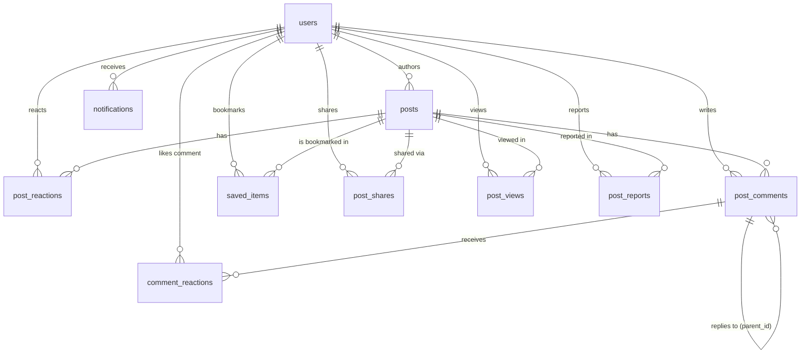

# KnotNex Social Platform — Database Schema & Data Modeling
**Engine:** PostgreSQL 15+  
**Target Schema:** Public relational schema with ACID transaction isolation  
**Migrations Applied:** `001_create_all_tables.sql` through `004_allow_write_post_type.sql`  

---

## 1. Entity Relationship (ER) Diagram



---

## 2. Table Schemas & Column Specifications

### 2.1 `posts`
Stores core publication records (text posts, media carousels, and vertical reels).

```sql
CREATE TABLE IF NOT EXISTS posts (
    id                  UUID PRIMARY KEY DEFAULT gen_random_uuid(),
    author_id           UUID NOT NULL REFERENCES users(id) ON DELETE CASCADE,
    caption             TEXT,
    media_urls          TEXT[] DEFAULT '{}',
    post_type           VARCHAR(20) NOT NULL DEFAULT 'post'
                        CHECK (post_type IN ('post', 'reel', 'write')),
    thumbnail_url       TEXT,
    tags                TEXT[] DEFAULT '{}',
    location            VARCHAR(255),
    audience            VARCHAR(30) DEFAULT 'public'
                        CHECK (audience IN ('public', 'connections', 'community', 'private')),
    category            VARCHAR(100),
    community           VARCHAR(100),
    tagged_users        UUID[] DEFAULT '{}',
    allow_comments      BOOLEAN DEFAULT TRUE,
    allow_reposts       BOOLEAN DEFAULT TRUE,
    
    -- Denormalized real-time counters (O(1) read performance)
    likes_count         INTEGER NOT NULL DEFAULT 0,
    comments_count      INTEGER NOT NULL DEFAULT 0,
    shares_count        INTEGER NOT NULL DEFAULT 0,
    save_count          INTEGER NOT NULL DEFAULT 0,
    views_count         INTEGER NOT NULL DEFAULT 0,
    
    is_moderated        BOOLEAN DEFAULT FALSE,
    flagged_for_review  BOOLEAN DEFAULT FALSE,
    created_at          TIMESTAMPTZ NOT NULL DEFAULT NOW(),
    updated_at          TIMESTAMPTZ NOT NULL DEFAULT NOW()
);
```

---

### 2.2 `post_reactions`
Stores unique per-user likes/reactions on posts.

```sql
CREATE TABLE IF NOT EXISTS post_reactions (
    id                  UUID PRIMARY KEY DEFAULT gen_random_uuid(),
    post_id             UUID NOT NULL REFERENCES posts(id) ON DELETE CASCADE,
    user_id             UUID NOT NULL REFERENCES users(id) ON DELETE CASCADE,
    reaction_type       VARCHAR(20) NOT NULL DEFAULT 'like',
    created_at          TIMESTAMPTZ NOT NULL DEFAULT NOW(),
    UNIQUE (post_id, user_id)
);
```

---

### 2.3 `post_comments`
Stores top-level comments and self-referencing threaded replies.

```sql
CREATE TABLE IF NOT EXISTS post_comments (
    id                  UUID PRIMARY KEY DEFAULT gen_random_uuid(),
    post_id             UUID NOT NULL REFERENCES posts(id) ON DELETE CASCADE,
    author_id           UUID NOT NULL REFERENCES users(id) ON DELETE CASCADE,
    parent_id           UUID REFERENCES post_comments(id) ON DELETE CASCADE,
    content             TEXT NOT NULL,
    likes_count         INTEGER NOT NULL DEFAULT 0,
    is_edited           BOOLEAN DEFAULT FALSE,
    created_at          TIMESTAMPTZ NOT NULL DEFAULT NOW(),
    updated_at          TIMESTAMPTZ NOT NULL DEFAULT NOW()
);
```

---

### 2.4 `comment_reactions`
Stores per-user likes on comments.

```sql
CREATE TABLE IF NOT EXISTS comment_reactions (
    id                  UUID PRIMARY KEY DEFAULT gen_random_uuid(),
    comment_id          UUID NOT NULL REFERENCES post_comments(id) ON DELETE CASCADE,
    user_id             UUID NOT NULL REFERENCES users(id) ON DELETE CASCADE,
    reaction_type       VARCHAR(20) NOT NULL DEFAULT 'like',
    created_at          TIMESTAMPTZ NOT NULL DEFAULT NOW(),
    UNIQUE (comment_id, user_id)
);
```

---

### 2.5 `saved_items`
Stores polymorphic bookmarks across posts, jobs, events, and schemes.

```sql
CREATE TABLE IF NOT EXISTS saved_items (
    id                  UUID PRIMARY KEY DEFAULT gen_random_uuid(),
    user_id             UUID NOT NULL REFERENCES users(id) ON DELETE CASCADE,
    item_id             UUID NOT NULL,
    item_type           VARCHAR(30) NOT NULL DEFAULT 'post'
                        CHECK (item_type IN ('post', 'event', 'job', 'scheme')),
    created_at          TIMESTAMPTZ NOT NULL DEFAULT NOW(),
    UNIQUE (user_id, item_id, item_type)
);
```

---

### 2.6 `post_shares`
Audit trail of internal and external shares.

```sql
CREATE TABLE IF NOT EXISTS post_shares (
    id                  UUID PRIMARY KEY DEFAULT gen_random_uuid(),
    post_id             UUID NOT NULL REFERENCES posts(id) ON DELETE CASCADE,
    user_id             UUID NOT NULL REFERENCES users(id) ON DELETE CASCADE,
    platform            VARCHAR(50) DEFAULT 'internal',
    shared_at           TIMESTAMPTZ NOT NULL DEFAULT NOW()
);
```

---

### 2.7 `post_views`
Deduplicated daily impression tracker (1 count per user per post per day).

```sql
CREATE TABLE IF NOT EXISTS post_views (
    id                  UUID PRIMARY KEY DEFAULT gen_random_uuid(),
    post_id             UUID NOT NULL REFERENCES posts(id) ON DELETE CASCADE,
    user_id             UUID NOT NULL REFERENCES users(id) ON DELETE CASCADE,
    viewed_at           DATE NOT NULL DEFAULT CURRENT_DATE,
    UNIQUE (post_id, user_id, viewed_at)
);
```

---

### 2.8 `post_reports`
Abuse reporting with privacy protection for the reporter.

```sql
CREATE TABLE IF NOT EXISTS post_reports (
    id                  UUID PRIMARY KEY DEFAULT gen_random_uuid(),
    post_id             UUID NOT NULL REFERENCES posts(id) ON DELETE CASCADE,
    reporter_id         UUID NOT NULL REFERENCES users(id) ON DELETE CASCADE,
    reason              VARCHAR(100) NOT NULL,
    details             TEXT,
    status              VARCHAR(20) NOT NULL DEFAULT 'pending'
                        CHECK (status IN ('pending', 'reviewed', 'dismissed', 'actioned')),
    created_at          TIMESTAMPTZ NOT NULL DEFAULT NOW(),
    UNIQUE (post_id, reporter_id)
);
```

---

## 3. High-Performance Indexing Strategy

```sql
-- Feed Filtering & Sorting Indexes
CREATE INDEX IF NOT EXISTS idx_posts_feed_sort        ON posts(created_at DESC) WHERE is_moderated = FALSE;
CREATE INDEX IF NOT EXISTS idx_posts_author           ON posts(author_id);
CREATE INDEX IF NOT EXISTS idx_posts_post_type        ON posts(post_type, created_at DESC);
CREATE INDEX IF NOT EXISTS idx_posts_audience         ON posts(audience);
CREATE INDEX IF NOT EXISTS idx_posts_category         ON posts(category);

-- Reaction & Bookmark Lookups
CREATE INDEX IF NOT EXISTS idx_post_reactions_lookup  ON post_reactions(post_id, user_id);
CREATE INDEX IF NOT EXISTS idx_saved_items_user_post  ON saved_items(user_id, item_id) WHERE item_type = 'post';

-- Comment Threading Indexes
CREATE INDEX IF NOT EXISTS idx_post_comments_thread   ON post_comments(post_id, created_at ASC);
CREATE INDEX IF NOT EXISTS idx_post_comments_parent   ON post_comments(parent_id);

-- Analytics & Moderation
CREATE INDEX IF NOT EXISTS idx_post_views_dedup       ON post_views(post_id, viewed_at);
CREATE INDEX IF NOT EXISTS idx_post_reports_status    ON post_reports(status);
```
