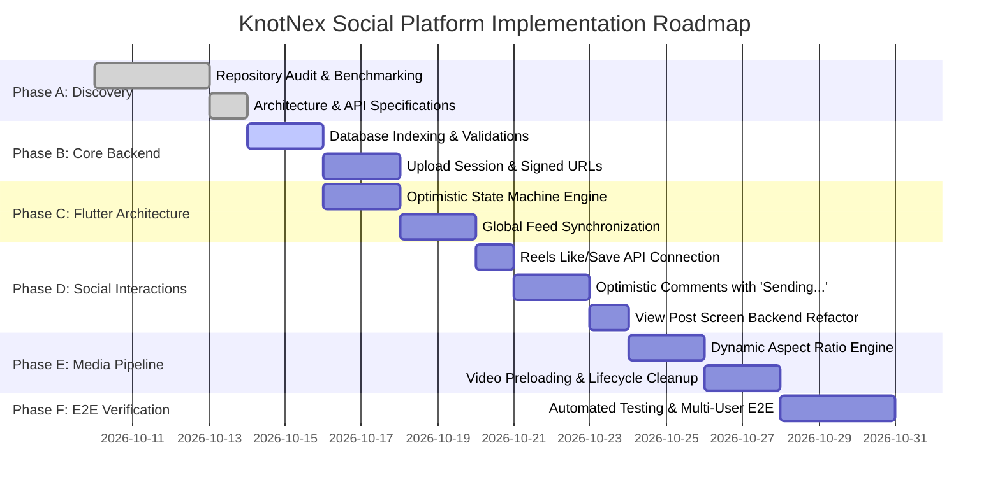

# KnotNex Social Platform — Master Implementation Roadmap
**Document Version:** 1.0.0  
**Methodology:** Controlled Incremental Phases with Testable Milestones  

---

## 1. Phase Breakdown & Execution Plan

---

## 2. Phase-by-Phase Deliverables & Acceptance Criteria

### Phase A — Discovery & Architecture (Completed)
- [x] Complete code inspection of `knotnex` and `knotnex_backend`.
- [x] Documented all gaps in `SOCIAL_FEATURE_AUDIT.md`.
- [x] Benchmarked Instagram & LinkedIn patterns in `INSTAGRAM_LINKEDIN_BENCHMARK.md`.
- [x] Published architecture, API, and database specifications.

### Phase B — Core Backend Hardening
- **Objective:** Finalize any missing routes, rate limiters, and foreign key validations.
- **Tasks:**
  1. Verify all foreign key cascade behaviors (`ON DELETE CASCADE`).
  2. Implement `POST /api/v1/media/upload-session` for short-lived direct GCS upload credentials.
  3. Validate database performance indexes using `EXPLAIN ANALYZE` on feed queries.
- **Acceptance Criteria:** Zero unhandled SQL errors; all API endpoints return standardized `{ success, data, error }` envelopes.

### Phase C — Flutter Interaction Architecture
- **Objective:** Establish the unified optimistic state machine across `FeedProvider`.
- **Tasks:**
  1. Introduce explicit mutation states: `Idle`, `Pending`, `Confirmed`, `Failed`, `Retrying`, `Reconciled`.
  2. Implement in-flight deduplication sets (`_inFlightLikes`, `_inFlightSaves`).
  3. Provide global notification listener for live count updates.
- **Acceptance Criteria:** Zero UI stalls during rapid like/unlike toggles; automatic rollback on network loss.

### Phase D — Social Interactions Remediation
- **Objective:** Fix disconnected interactions identified in the audit.
- **Tasks:**
  1. **Connect Reels Screen to Backend:** Wire `reels_screen.dart` like, double-tap, bookmark, and share to `FeedProvider`.
  2. **Refactor Single Post View:** Replace isolated mock state in `view_post_screen.dart` with `FeedProvider.fetchComments()` and `FeedProvider.addComment()`.
  3. **Implement Optimistic Comments:**
     - When user sends a comment: generate client temp ID, insert into tree with `isPending: true` and `Sending...` label.
     - Upon API resolution: replace temp ID with server UUID, clear pending label.
     - On failure: display retry button.
  4. **Add Report Action to Reels:** Provide 3-dot options menu on Reels screen with report modal.
- **Acceptance Criteria:** Engagement actions in Reels instantly reflect in Home Feed and database; comments show instant local feedback.

### Phase E — Media & Creation Pipeline
- **Objective:** Enhance media aspect ratios and video playback lifecycle.
- **Tasks:**
  1. Calculate dynamic aspect ratios in `PostCard` to prevent cropping landscape (16:9, 1.91:1) and portrait (4:5) photos.
  2. Optimize video memory in `ReelsScreen` by preloading the next buffer and disposing distant controllers.
  3. Wire `CreateReelScreen` to real video picker and GCS upload pipeline.
- **Acceptance Criteria:** No image stretching or awkward cropping; video scrolling runs smoothly at 60 FPS without memory leaks.

### Phase F — Feed, Discovery & Notifications
- **Objective:** Polish feed ranking and notification delivery.
- **Tasks:**
  1. Implement cursor-based pagination for rapid infinite feed scrolling.
  2. Wire FCM push notification handling for foreground and background social events.
  3. Verify unread notification badges in bottom navigation bar.
- **Acceptance Criteria:** Real-time badge counter increments when another user likes or comments on the post.

### Phase G — Accessibility & Security
- **Objective:** Verify inclusive UX and data safety.
- **Tasks:**
  1. Provide screen-reader semantics for all like, comment, share, and save buttons (`Semantics(label: "Like post, 42 likes")`).
  2. Ensure color contrast ratios $\ge 4.5:1$ against purple primary `#6336EB`.
  3. Verify reporter privacy on abuse reports.
- **Acceptance Criteria:** Screen readers navigate feed without focus traps; all user IDs validated against JWT token.

### Phase H — End-to-End Verification
- **Objective:** Multi-user live testing and verification.
- **Tasks:**
  1. Execute multi-user user journey: User A posts image -> User B likes & comments -> User A receives notification -> User B saves post.
  2. Verify offline resilience and reconnection behavior.
  3. Run Dart analyzer and test suites.
- **Acceptance Criteria:** All verification tests pass with 0 errors.
