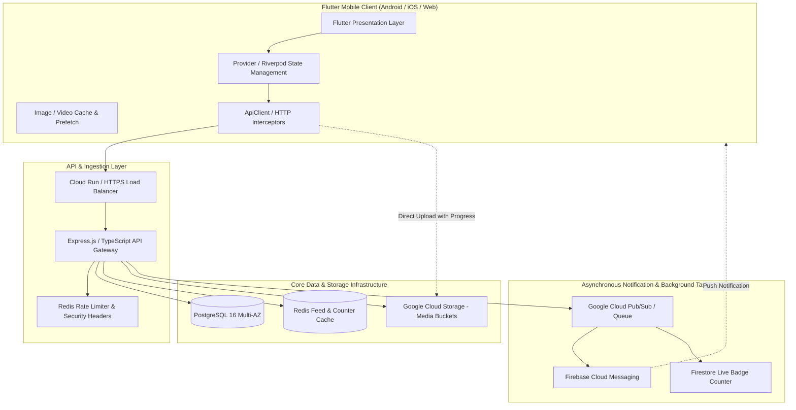
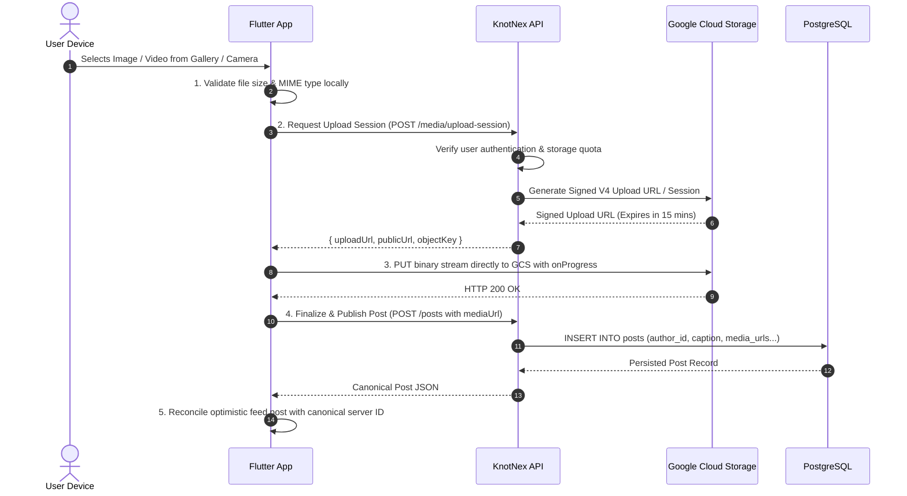

# KnotNex Social Platform — System Architecture & Technical Design
**Document Version:** 1.0.0  
**Scope:** Client Architecture, Backend Micro-Services, Real-Time Messaging & Cloud Infrastructure  

---

## 1. High-Level System Architecture



---

## 2. Client-Side State Management & Interaction Pipeline

The Flutter application relies on clean separation of concerns:
1. **`FeedProvider` (Domain State Machine):**
   - Stores the authoritative list of active posts (`_allPosts`).
   - Maintains in-flight lock sets (`_inFlightLikes`, `_inFlightSaves`, `_inFlightShares`) preventing race conditions during rapid taps.
   - Executes optimistic UI mutations immediately.
   - Synchronizes response payloads from the backend back into the state tree.
   - Reverts state gracefully with informative toasts upon network error.
2. **`PostCard` & `ReelsScreen` (UI Presentation):**
   - Consumes `FeedProvider` data.
   - Provides smooth micro-interactions (heart bounce, bookmark toggle, video controls).
   - Manages local video controller disposal to prevent Out-Of-Memory (OOM) crashes during long feed scrolls.
3. **`CommentsBottomSheet` & `ViewPostScreen` (Conversation Subsystems):**
   - Operates a threaded comment tree model (`CommentNode`).
   - Supports 2-level nesting (`parentId`).
   - Implements optimistic submission with `isPending` state and failure retry mechanisms.

---

## 3. Media Ingestion & Direct Cloud Storage Pipeline



---

## 4. Video & Reel Lifecycle Architecture

1. **Viewport Detection:**
   - `PostCard` registers a scroll listener to detect when a video post occupies $\ge 60\%$ of the screen viewport.
   - Autoplay is engaged only on the primary active card; all other off-screen controllers are immediately paused.
2. **Reels Swiping (`PageView.builder`):**
   - The active reel plays with looping enabled.
   - Adjacent video (index + 1) initiates preloading of the initial buffer chunk to ensure zero black-frame latency during upward swipes.
   - When the user swipes past a video, its `VideoPlayerController` pauses, and controllers older than $\pm 2$ pages are disposed to preserve device RAM.
3. **Global Mute State:**
   - Synchronized across cards via `PostCard.globalFeedMutedNotifier`.
   - When the user toggles mute on one card or reel, all other in-feed videos mirror the user's audio preference.

---

## 5. View Tracking & Deduplication Engine

To handle high-scale scrolling without overwhelming the database with single-row inserts:
1. `ViewTrackingService.instance` in Flutter buffers post IDs exposed to the user for $\ge 1.5$ seconds.
2. Every 10 seconds (or upon screen transition), the buffer flushes via `POST /posts/views/batch` with an array of up to 50 UUIDs.
3. Backend executes a single bulk SQL statement:
   ```sql
   INSERT INTO post_views (post_id, user_id, viewed_at)
   SELECT unnest($1::uuid[]), $2, CURRENT_DATE
   ON CONFLICT (post_id, user_id, viewed_at) DO NOTHING;
   ```
4. Only newly registered daily views increment the denormalized `posts.views_count` counter.
